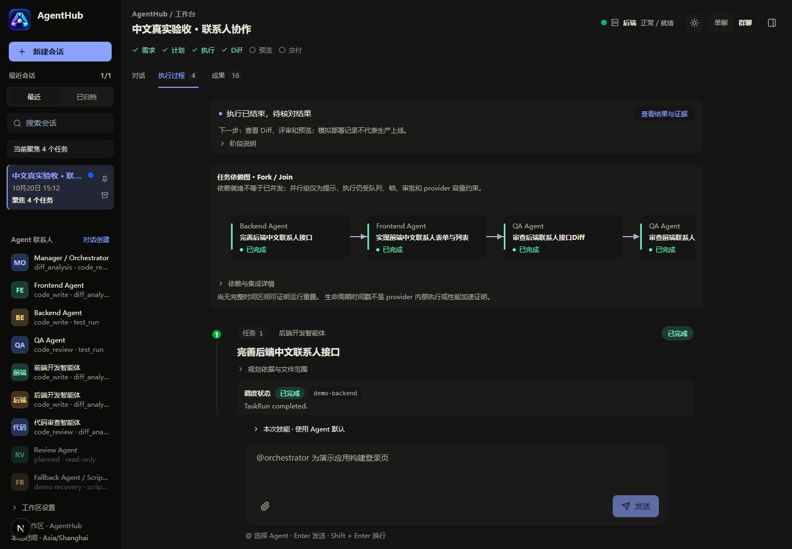
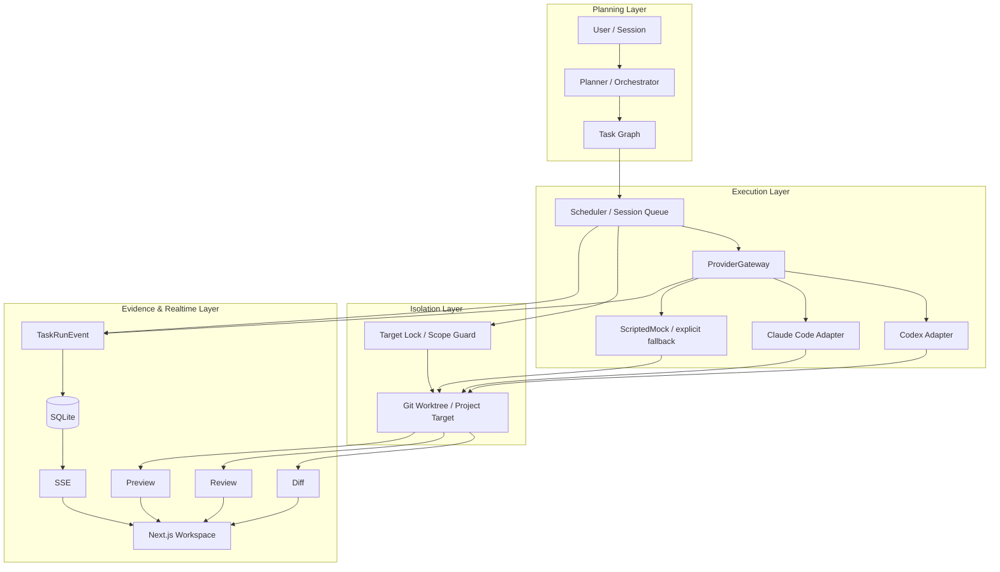
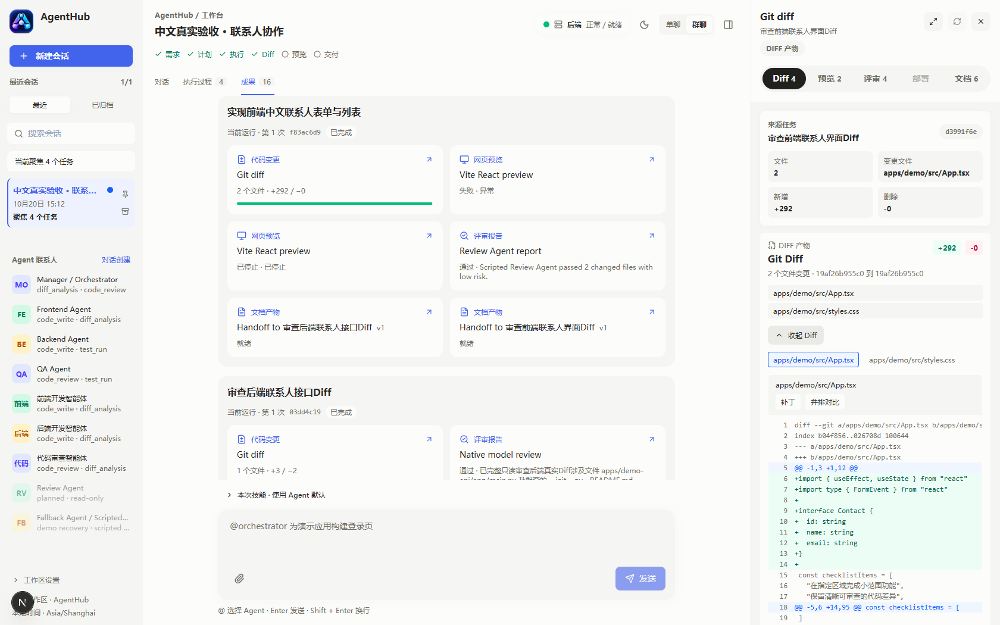
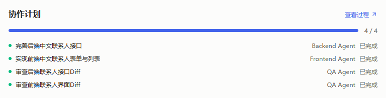
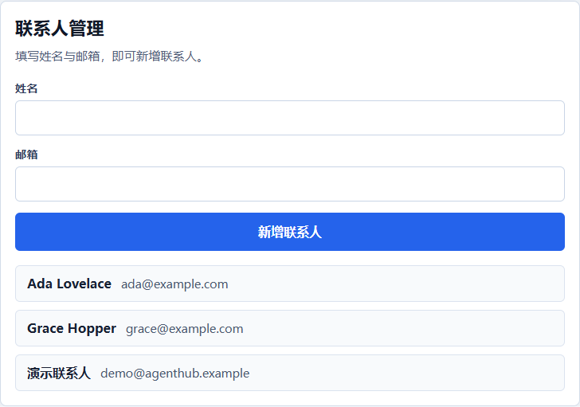
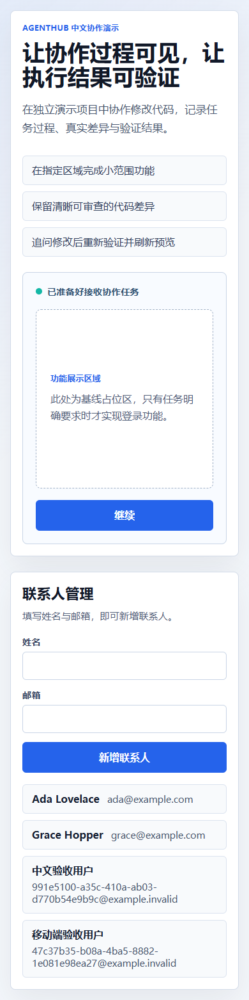

<div align="center">


# AgentHub

### 面向本地开发的多 Agent 编程工作台

**在同一工作台提出需求、协调角色、查看代码变更，逐项核对执行结果。**

<p>
  
  
  
  
  
  
</p>


[核心能力](#核心能力) · [系统架构](#系统架构) · [执行链路](#执行链路) · [技术栈](#技术栈) · [核心模块](#核心模块) · [快速开始](#快速开始) · [交付文档](#交付文档)

</div>

---

## 项目简介

AgentHub 是一个面向**本机单用户开发**的 IM 式多 Agent 编程工作台。你可以在会话中用中文提出需求，指定前端、后端或评审角色，查看任务依赖和执行进度，再打开真实 Git Diff、评审报告及 Vite React 预览继续修改。

项目关注三个实际问题：多角色任务如何按依赖推进，不同会话如何隔离代码修改，以及执行结束后如何核对结果。后端通过 **Task / TaskRun / TaskRunEvent** 组织计划、运行和事件，前端分别展示对话、执行过程和成果。

> 当前定位：本地单用户 Agent Coding Workspace。保留 Codex、Claude Code 和显式 ScriptedMock 兜底；支持内置前后端目标及受限外部目标。任务完成、检查通过、模型评审和预览健康是不同证据，需要分别查看。暂不提供多用户协作或生产部署。

```text
User Request
    ↓
Planner / Orchestrator
    ↓
Task Graph
    ↓
Scheduler
    ↓
ProviderGateway
    ↓
Coding Agent
    ↓
Git Worktree / Project Target
    ↓
Diff / Review / Preview
    ↓
TaskRunEvent → SSE → Web Workspace
```



*从任务拆解到多 Agent 执行，再查看真实 Diff、审查结果与应用预览。侧栏的协作 Agent 用于选择角色和 @ 分派任务。*

---

## 交付文档

| 文档 | 用途 |
|---|---|
| [`docs/local-usage.md`](docs/local-usage.md) | 本地安装、统一启动、Agent 配置、使用与故障恢复 |
| [`docs/local-project-delivery.md`](docs/local-project-delivery.md) | 原始设计要求与当前个人项目的实现、验证边界 |
| [`docs/demo-script.md`](docs/demo-script.md) | 录屏、现场演示和答辩脚本 |
| [`docs/architecture.md`](docs/architecture.md) | 架构、核心链路、模块地图和可靠性边界 |
| [`docs/project-state.md`](docs/project-state.md) | 当前基线、冻结证据、已知限制与交付状态 |
| [`docs/database-migrations.md`](docs/database-migrations.md) | SQLite / Alembic 离线迁移、备份与已有数据兼容 |
| [`docs/container-validation.md`](docs/container-validation.md) | 可选 Docker 固定检查与测试，区别于 Agent 容器化 |
| [`docs/chinese-usage-latency-validation-20261020.md`](docs/chinese-usage-latency-validation-20261020.md) | 历史同版中文 50 次评测、Token 与阶段耗时，含失败和分母 |
| [`docs/real-api-stability-validation-20261022.md`](docs/real-api-stability-validation-20261022.md) | 后续原生 QA 修复和独立复验，不回写历史评测 |
| [`docs/ordered-local-improvements.md`](docs/ordered-local-improvements.md) | 同版本原生 QA 评测、业务验收扩展与职责拆分的本地证据和范围 |
| [`AGENTS.md`](AGENTS.md) | AI 协作守则和项目 guardrails |
| [`openspec/changes`](openspec/changes) | Spec、任务拆解和演进记录 |
| [`docs/change-log.md`](docs/change-log.md) | 当前工程变更和验证记录 |
| [`docs/history/README.md`](docs/history/README.md) | 历史状态与旧变更记录索引 |

---

## 核心能力

| 能力                          | AgentHub 的实现                                              |
| ----------------------------- | ------------------------------------------------------------ |
| **任务规划与意图识别** | 识别角色提及、受支持意图及拒绝边界；可选原生 Planner 输出结构化计划，再校验目标、路径、命令与依赖 |
| **角色与运行时配置** | 支持角色名称、别名、提示词及受限自定义档案；ProviderGateway 解析兼容 Provider、检查健康和容量 |
| **会话与写入隔离** | 每个 Session 独立 Git Worktree；Session Queue、Scheduler 与 Target Lock 控制依赖和目标写竞争 |
| **过程可视化与恢复** | 任务图、状态、事件时间线与运行诊断；TaskRunEvent 持久化后通过 SSE 推送，支持游标重放和心跳 |
| **代码与成果工作台** | 查看真实 Diff、只读评审、文档版本和 Vite React 预览；输入框随内容增高，窄屏适配可见区域；保留产物来源及当前/历史运行区别 |
| **版本绑定的分项验收** | 内置 Vite/FastAPI 固定检查绑定源码、策略与执行代次；旧成功不能验收新代码，模型评审独立显示 |
| **评审、修复与重试** | 选择具体发现准备修复草稿，显式发送后重新检查；支持中断、重试及明确标识来源的脚本兜底 |
| **记忆与上下文** | 作用域记忆、冻结快照、置顶消息、附件与代码片段引用；按预算组装，超限拒绝而不静默丢弃必要规则 |
| **Skills 与受控 MCP** | 技能说明按版本冻结；兼容 Codex 可通过内置网关只读查询项目文档，不支持任意服务器或写工具 |
| **可观测用量** | 保存可获得的 CLI Token 回执与排队、规划、执行、收尾等耗时；未知值保留未知，应用观测不冒称上游 TTFT |
| **本地数据维护** | SQLite / Alembic 管理版本；已有库离线备份迁移，另有一致快照、恢复演练和受限缓存隔离 |
| **可选容器验证** | 操作者可为服务器固定检查/测试选择预制 Docker 镜像；默认 native，Agent CLI、预览和浏览器保持原生 |

本地个人项目的当前能力和证据见 [交付核对](docs/local-project-delivery.md)。
源码实现、最近验收和未提交改动以 [当前项目状态](docs/project-state.md) 为准；历史 CI 通过不能验证后续本地改动。
固定检查只覆盖其明示契约，不等于任意业务功能正确或通用恶意代码沙箱。

<details>
<summary>查看历史真实任务评测及其适用范围</summary>

2026-10-20 的冻结版本，对五类固定中文场景各执行 10 次：严格完整验收 **40/50**，独立业务契约 **46/50**，另有 3 次失败、1 次未完整验证。单独的受控故障恢复 **10/10**，不并入普通任务分母。

198 条去重逻辑调用/尝试记录中，197 条有完整 Token 回执；已知小计 4,382,605 Token，剩余 1 条超时未知，完整总量不填零。任务流程 P50 / P95 为 90.437 / 372.703 秒，仅描述该机器、该版本与这些重复场景。

这些结果不代表当前版本的任意任务成功率，也不是生产 HTTP 压测。截图选取通过样本用于展示，完整统计保留全部失败；后续修复另存记录。详见[评测定义与完整结果](docs/chinese-usage-latency-validation-20261020.md)及[后续修复记录](docs/real-api-stability-validation-20261022.md)。

2026-10-25 另做五类中文场景各两次的独立复验，严格通过 **8/10**，两项联系人前端超时。修复实测发现的平台问题后，另用新会话完成当前版本的真实 HTTP、原生编码/QA、Diff 与 Vite 预览验收；两批结果分别保留，不合并分母。见[本轮实测与复现说明](docs/workflow-evaluation.md)。

</details>

---

## 系统架构



### 四层设计

| 层级          | 关键模块                                     | 主要职责                               |
| ------------- | -------------------------------------------- | -------------------------------------- |
| **Planning**  | Planner、Orchestrator、Task Graph            | 需求理解、角色路由、任务拆解与依赖组织 |
| **Execution** | TaskRun、Scheduler、ProviderGateway、Adapter | 任务调度、Provider 选择与 Agent 执行   |
| **Isolation** | Git Worktree、Target Scope、Target Lock      | 工作区隔离、代码边界与并发写保护       |
| **Evidence**  | Diff、Review、Preview、TaskRunEvent、SSE     | 结果验证、执行追踪与前端实时展示       |

---

## 执行链路

### 1. Planning & Task Graph

Planner / Orchestrator 先解析角色提及和意图。规则处理明确支持的需求与边界；启用原生 Planner 后，由模型生成结构化计划，再经过同一套任务图、路径和命令校验。讨论、拒绝或澄清不会伪装成已执行任务。

```text
User Request
    ↓
Intent / Mention Parsing
    ↓
Planner / LLM Planner
    ↓
Task Graph Validation
    ↓
Executable Tasks
```

每个 Task 主要描述：

- `role`：由哪个角色执行，如 frontend / backend / qa；
- `target`：任务允许作用的代码目标；
- `dependsOn`：任务之间的依赖关系；
- `intent`：任务需要完成的工程目标。

---

### 2. Scheduling & Isolation

任务进入执行阶段后，Scheduler 根据依赖、访问模式和目标锁判断是否可运行。

```text
TaskRun
   ↓
Dependency Check
   ↓
Session Queue
   ↓
Target Lock
   ↓
Worktree / Target
```

核心策略：

- 只读任务可并发执行；
- 写任务进入 Session 写队列；
- 同一目标通过 Target Lock 建立互斥边界；
- Session 之间使用独立 Git Worktree 隔离工作目录；内置 Demo 的显式隔离写任务可在执行工作树校验后汇合；
- 路径范围、禁止文件、固定命令、CLI 原生限制和预览 iframe 各自承担不同边界，Worktree 本身不等于安全沙箱。

默认检查在 native 后端执行；可选 Docker 仅运行服务器固定检查/测试，不将 Agent CLI、预览或整个平台放入容器。环境变量、工具及预览权限详见[架构边界](docs/architecture.md#可靠性边界)和[容器验证说明](docs/container-validation.md)。

---

### 3. Provider Runtime

上层任务不直接依赖具体模型或 CLI。

ProviderGateway 位于 TaskRun 与 Coding Runtime 之间，统一负责：

- 根据 role / target / capability 解析运行 Provider；
- Provider 健康检查；
- 容量与并发控制；
- Adapter 能力匹配；
- Provider 运行证据与事件记录。

当前主要 Coding Adapter：

```text
CodexAdapter
ClaudeCodeAdapter
ScriptedMockAdapter  # 显式兜底：按受支持模板真实修改文件，不调用模型
```

因此 Planner、Task Graph 与 TaskRun 可以保持稳定，而底层 Coding Runtime 可以独立配置和扩展。

---

### 4. Evidence & Realtime Trace

Agent 退出后，系统继续收集真实文件变化并核对完成条件。内置目标的固定检查、模型静态评审和预览健康分别记录；源码改变后，旧验证回执会过期。

```text
Coding Agent
    ↓
File Changes
    ↓
Diff / Review / Preview
    ↓
TaskRunEvent
    ↓
SQLite
    ↓
SSE
    ↓
Web Workspace
```

| 结果             | 作用                                     |
| ---------------- | ---------------------------------------- |
| **Diff**         | 查看真实文件修改与代码变化               |
| **Review**       | 对代码变更形成结构化审查结果             |
| **Preview**      | 启动并展示本地 Web 预览                  |
| **TaskRunEvent** | 持久化任务执行状态与运行轨迹，并提供 Session 级 SSE 恢复游标 |
| **Diagnostics**  | 汇总 Queue、Provider、Preview 等运行状态 |
| **Validation**  | 对内置目标记录与当前源码/策略绑定的分项检查，保留失败及不适用项 |
| **Usage & Timing** | 保存可获得的 Token 用量和分阶段耗时，缺失回执不补造 |



*真实 Diff 将任务与文件增删对应起来。图中示例补齐记录保存逻辑，并修正邮箱判重。*

<details>
<summary>示例应用：用联系人管理验证前后端协作</summary>

联系人管理是 Agent 生成的示例业务，用来验证后端接口、前端表单与 QA 审查的协作链路，不是 AgentHub 自身的通讯录功能。





*新增联系人后更新列表，刷新页面仍可从当前服务读取记录。*



*重复邮箱被拒绝时保留输入与已有列表，方便修改后继续提交。*

</details>

---

## 技术栈

| 模块              | 技术                                                    |
| ----------------- | ------------------------------------------------------- |
| **Web Workspace** | Next.js App Router、React、TypeScript、Tailwind CSS、本地 UI 组件 |
| **API**           | FastAPI、Pydantic、SQLModel                             |
| **Persistence**   | SQLite、SQLModel、Alembic 版本迁移                        |
| **Realtime**      | Server-Sent Events (SSE)                                |
| **Agent Runtime** | Codex CLI、Claude Code CLI、Adapter Abstraction         |
| **Isolation**     | Git Worktree、Target Scope、Target Lock                 |
| **Fixed Validation** | 原生固定检查；可选 Docker 预制验证镜像，不是通用 Agent 沙箱 |
| **Demo Frontend** | Vite + React                                            |
| **Specification** | OpenSpec                                                |

---

## 项目结构

```text
AgentHub/
├── apps/
│   ├── api/        # FastAPI Agent Runtime
│   ├── web/        # Next.js Workspace
│   ├── demo/       # Vite React 示例目标
│   └── demo-api/   # FastAPI 示例后端目标
├── docs/           # Architecture / project docs
├── openspec/       # Spec / change records
└── scripts/        # Development scripts
```

---

## 核心模块

| 文件                     | 职责                                                 |
| ------------------------ | ---------------------------------------------------- |
| `planning.py`            | Mention 解析、Planner / LLM Planner、Task Graph 生成 |
| `planning_intents.py / intent_decisions.py` | 规则边界与统一意图识别结果，配套固定评测集 |
| `run_engine.py`          | TaskRun 主执行链路与运行生命周期                     |
| `provider_gateway.py`    | Provider 解析、健康、容量与运行时映射                |
| `scheduler.py`           | 任务依赖与可运行状态判断                             |
| `session_queue.py`       | Session 内任务队列与读写调度                         |
| `target_locks.py`        | Target 写锁管理                                      |
| `codex_adapter.py`       | Codex CLI 执行适配                                   |
| `claude_code_adapter.py` | Claude Code CLI 执行适配                             |
| `diffs.py`               | Git / 文件变更采集                                   |
| `previews.py`            | 本地 Preview 生命周期管理                            |
| `skills.py / mcp_gateway.py` | 版本冻结技能包及受控只读项目文档工具                |
| `memory_snapshots.py / memory_retrieval.py` | 作用域记忆、冻结快照及有界上下文检索       |
| `db_migrations.py`       | SQLite 状态检查、一致备份与 Alembic 离线升级            |

以上文件位于 [`apps/api/app`](apps/api/app)。完整前后端模块地图见[架构说明](docs/architecture.md)。

---

## 快速开始

### 环境要求

- Node.js `^20.19.0 || ^22.12.0 || >=24.0.0`
- pnpm 10.33.4（以 `package.json` 的 `packageManager` 为准）
- Python 3.11+（当前代码使用 `datetime.UTC`）
- Git

当前锁文件中的 Vite 8 要求 Node `^20.19.0 || >=22.12.0`。Node 22.11 等更早的
22.x 版本可能在 Vitest 启动阶段表现为 `ERR_REQUIRE_ESM`。

### 1. 安装 JavaScript 依赖

```bash
pnpm install
```

仓库仅放行 `esbuild`、`sharp`、`unrs-resolver` 三个工具链依赖的构建脚本。不要使用
全量 `pnpm approve-builds --all` 绕过 `pnpm-workspace.yaml` 中的最小 allowlist。

### 2. 创建 Python 环境

macOS / Linux：

```bash
python3 -m venv .venv
.venv/bin/pip install -r apps/api/requirements.txt
```

Windows：

```powershell
python -m venv .venv
.venv\Scripts\pip install -r apps\api\requirements.txt
```

### 3. 安装 Demo 应用依赖

```bash
pnpm demo:setup
```

### 4. 检查并启动

```bash
pnpm doctor:local
pnpm dev:local
```

打开 `http://127.0.0.1:3000`。统一入口无需 Bash，自动初始化空 SQLite 或检查已有库版本，
启动产品 API 和 Web，等待实际就绪后给出地址；按 Ctrl+C 清理本次启动的服务。
启动不会安装依赖、重置数据库或执行模型。首次需要在界面新建会话。
已有无版本库须先停机并按[数据库迁移说明](docs/database-migrations.md)创建一致备份、离线升级；启动不再自动补列。

端口被其他服务占用时可显式指定，前后端地址及 CORS 会一起同步：

```bash
pnpm dev:local --api-port 8001 --web-port 3001
```

需要内置演示后端时加 `--demo-api`，它使用目标契约固定的 5174 端口：

```bash
pnpm dev:local --demo-api
```

Session 网页预览仍由 API 在实际运行的工作树中启动，不能用仓库根目录 Demo
页面代替 Agent 结果。详细配置、备份与恢复见 [本地使用说明](docs/local-usage.md)。

修改产品 API 源码时需要自动 reload，可继续分别使用 `pnpm dev:api` 和
`pnpm dev:web`；旧后端包装命令需要 Bash，统一入口的 API 不启用 reload。

### 5. 发送任务

```text
@orchestrator 为演示应用构建一个登录页
```

默认自动组会依次规划、执行、评审并汇总；历史手动计划仍可逐项启动。
真实执行需要在“工作区设置 → 运行设置”选择可用的本机 Codex/Claude Code，
执行失败可显式使用 ScriptedMock 兜底。脚本兜底不执行模型提示词，不应被视为
真实 Agent 成功。

第一次运行可按“对话 → 执行过程 → 成果”查看：先核对计划与修改范围，再检查 Diff 和分项 QA；需要预览时打开 Vite React 结果。遇到失败先查看运行原因，重试保留原记录。主工作台的成果区会区分当前运行和历史结果，空面板可收起，两侧分界支持拖动。

系统将进入：

```text
Planning
→ Task Graph
→ Scheduling
→ Coding Agent
→ Diff / Review / Preview
→ TaskRunEvent / SSE
```

### Python 环境与旧包装脚本

统一入口和旧后端包装命令会识别显式
`AGENTHUB_PYTHON_BIN`、当前工作树 `.venv`、主检出目录共享 `.venv` 以及激活的
Conda 环境。统一入口会拒绝无效的显式 Python 路径。旧检查/测试/数据库命令
仍通过 Bash 运行；pytest 使用运行级唯一、自动清理的外部临时目录。

---

## 常用命令

```bash
pnpm doctor:local  # 只读检查依赖和端口，不调用模型
pnpm dev:local     # 一起启动产品 API 和 Web，退出清理自有服务
pnpm test:local    # 启动器定向测试，亦包含在 pnpm test
pnpm dev:web       # 启动 Web Workspace
pnpm dev:api       # 启动 FastAPI
pnpm demo:dev      # 启动 Demo App
pnpm db:init       # 初始化空库或为 current 库补缺失种子
pnpm db:status     # 只读检查数据库版本
pnpm db:migrate --backup-dir <新建的外部绝对目录> # 停机、一致备份与离线升级
pnpm check         # 代码检查
pnpm test          # 运行测试
```

---

<div align="center">


### AgentHub

**让协作过程可见，让执行结果可检查。**

</div>
