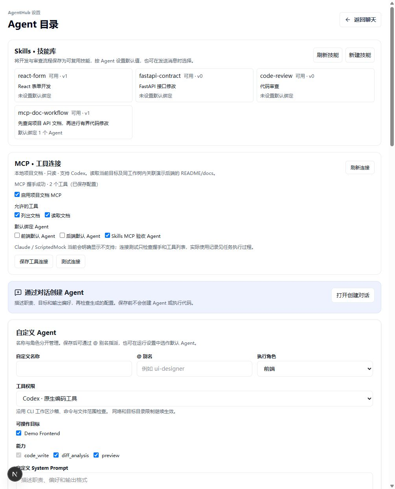
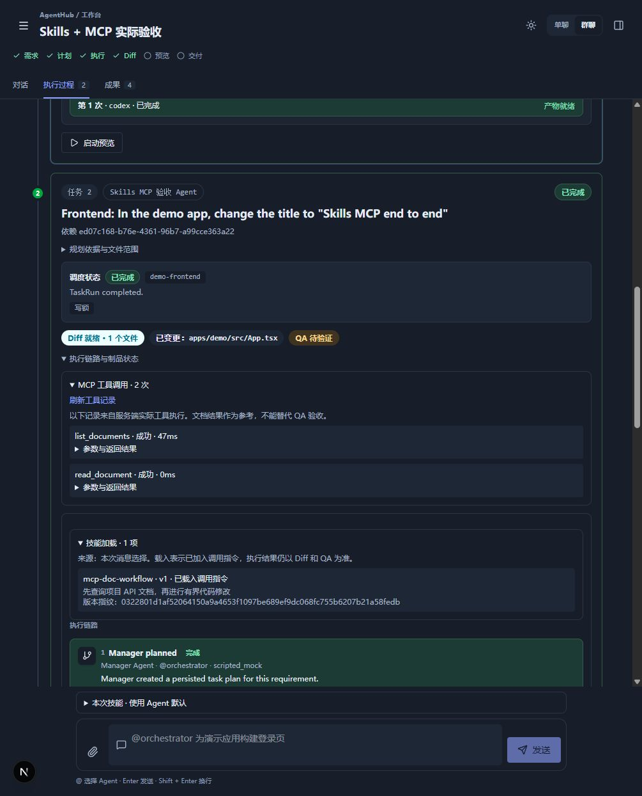
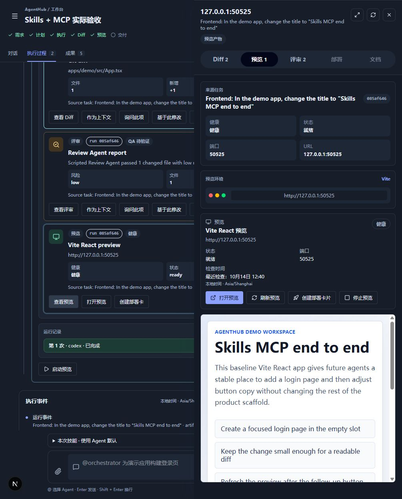
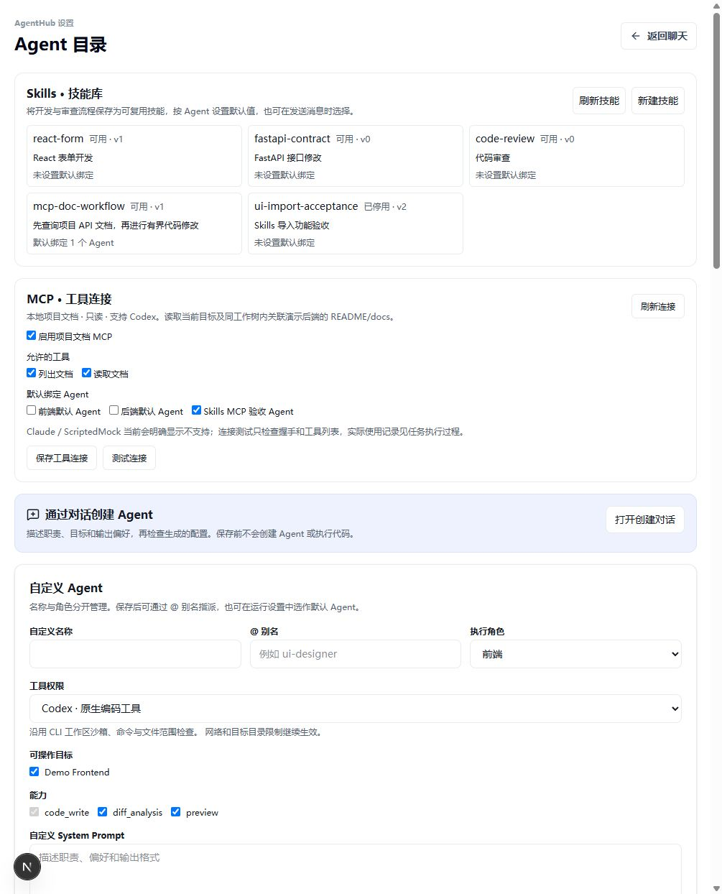

# Skills 与文档 MCP 本地验收

2026-10-14，开发分支 `dev`，基础 HEAD `68aa0a1`；验收时实现尚未提交/推送，当前交付状态以 Git 历史为准。

## 实际调用与结果

验收会话 `efaba891-20af-4c9e-81ea-beca298eb3d3`，真实 Codex 运行
`085af646-f568-4506-9437-de2f3d49dc53`，原生 Adapter run
`codex-63fba8ad-d8cd-4dc8-8f19-e9fec3a0793a`。

- 自定义 Codex 前端 Agent 载入 `mcp-doc-workflow` v1 的冻结指令。
- 通过真实 MCP HTTP 连接执行 `list_documents` 与 `read_document`，协议 `2025-06-18`。
- 读取 `demo-backend:README.md`，来源 `apps/demo-api/README.md`，原始 SHA-256
  `998991ab35d6a1ba213ecbf8b9abb02b1d9243da0ca36da021eb386a3736c396`。
- 真实 Diff 修改 `apps/demo/src/App.tsx` 的 h1 为 `Skills MCP end to end`，+1 / −1。
- 服务端固定类型检查、可信构建与 3 项产物冒烟测试均 exitCode=0。
- 需求契约在桌面与窄屏中检查标题和页面运行，4 项 passed，浏览器版本 `155.0.4283.45`。
- 版本绑定证据查询为 current；Vite 预览 ready/healthy，实际 iframe 展示新标题。

原始有界 API 证据见 [runtime-acceptance.json](runtime-acceptance.json)。只保存公共技能/工具记录、
Diff、验证和 QA 分项，不保存运行凭据、内部指令快照或完整原生日志。
本地验收数据通过真实设置 API 保存在 SQLite，重启 API 后技能/连接仍存在。
只绑定新建的“Skills MCP 验收 Agent”；没有把 MCP 设为原有角色的默认连接。

## UI

真实浏览器检查亮色设置页、暗色过程/结果、技能与工具记录展开，以及 390px 设置页
`scrollWidth=clientWidth=390`。连接探测实际执行 HTTP 握手与工具发现。
通过真实文件选择器导入 `SKILL.md`，保存 `ui-import-acceptance` v1 后停用为 v2；
没有默认绑定，不参与后续运行。

## 证据边界与发现

这次原生执行成功不是 ScriptedMock 编码结果。自动 check/build/test/标题契约通过，
但模型审查没有运行，整体 QA 仍是 incomplete，不能据此宣称任意业务需求或完整 QA 通过。
该 MCP 只支持 Codex 的内置只读文档服务，不代表任意 MCP Server 或 Claude MCP 已验证。
Skills 首版只加载文本说明和参考资料，不执行脚本，也不能授予新权限。

首次运行 `ce55d5a0-86e0-46bd-a50b-d2d217a95dcb` 同样完成真实工具调用与文件修改，
但可信构建配置检查因 Windows CRLF 换行返回 unavailable。修复仅归一化配置比较时的换行，
源码指纹仍保留真实字节；上述新运行验证成功，未改写首次历史记录。

现有诊断器还会按关键词把正常原生输出、成功验证和模型列表刷新超时误归为故障因子。
本任务修复 MCP 文档内容触发的误报；其余诊断误报保留为后续独立任务，未作为验收证据。

## 检查

| 要求 | 实现和验证来源 |
|---|---|
| 工作区技能包、内置技能、导入、启停、默认绑定与消息覆盖 | `skills.py` / `routes/skills.py` / Skills 设置与选择组件；`test_skills.py`、`skills.test.tsx` 与真实文件导入/保存/停用 |
| 内容、身份、版本冻结及重试沿用 | 消息选择与 `skillBinding`；`test_real_run_freezes_defaults_and_request_uses_old_content`、消息重生成和篡改/跨工作区拒绝测试 |
| Planner / 原生调用加载及兼容性证据 | `llm_planner.py`、启动边界、`skill_runtime.py`；Planner 指令/公开 receipt 测试、受控 Claude 调用链、上述真实 Codex 加载事件 |
| 技能不能扩权限、脚本不执行 | 有界资源验证、既有命令/目录守卫；脚本/路径拒绝、ScriptedMock 跳过及现有 adapter/guardrail 回归 |
| 真实 MCP 协议、工具发现和模型调用 | 回环 HTTP JSON-RPC 网关、真实握手探测、上述原生 Codex 两次实际调用；`test_real_json_rpc_handshake_discovery_read_and_durable_receipts` |
| 分配目标范围、来源指纹和冻结文档 | `snapshot_documents` / `read_document`；真实来源哈希、快照修改/链接拒绝测试，以及额外禁止路径/外部宿主目录拒绝测试 |
| 凭据、执行身份、租约、队列、锁、撤销与过期 | 内存凭据、`authorize_value`、原生 interrupt/cleanup；八类执行/策略失效、过期、probe 权限和清理测试；API 重启不恢复任何 token |
| 不扩 Codex 网络/进程/命令权限 | 固定 config 参数、中央守卫、shell 环境排除；任意服务器参数拒绝、凭据不进入 command/model/repr/事件的测试 |
| 有界参数、次数、输出及实际证据 | 固定工具/schema、8 KB 请求限制、16 次调用、16 KB/文件和 16 文件/64 KB 快照；无工具/path/URL 泛化入口，非法参数/大请求/调用预算测试及实际记录 |
| 配置、实际使用、QA 和适配器兼容性分别显示 | MCP 设置/证据组件、技能 receipt、SSE 事件标签；Web 测试、亮暗/窄屏、真实过程与成果预览 |
| 原工作流及 SQLite 持久化 | 原适配器/TaskRun/Planner/审查等相关与全量回归；SQLite 关闭重开、实际 API 重启后的配置读取 |
| 任务、说明与证据可核验 | OpenSpec、使用说明、状态表、变更日志和本证据目录；严格规范及空白检查 |

API 全量 **2,074 passed / 1 skipped**（1425.37 秒）。全量启动后补充的文档目标额外禁止路径
检查，另由最终 MCP 模块 **23 passed** 覆盖（含真实 JSON-RPC 正向调用及外部目标拒绝路径）。
此前 API 定向 70 passed（MCP、自动验证、诊断），Skills 与既有运行相关合并 506 passed。
Web 全量 **291 passed / 37 files**，启动器 **17 passed**，demo-api **5 passed**，
根 `pnpm check`、strict OpenSpec 与 `git diff --check` 通过。
最终 API 重启后再次确认已保存配置、停用的导入技能和真实 HTTP 握手。
重启导致旧预览进程失效，已通过正常预览入口重新启动为 ready/healthy；保留旧记录，
新的预览 ID 与健康结果见 JSON 的 `finalRestartPreview`，没有把旧 URL 冒充仍可用。
两个 OpenSpec 任务已关闭；以上为本地验收结果，未用远程 CI 作通过证据。
