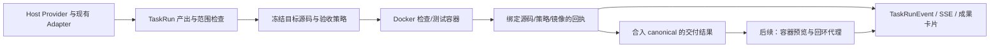

# AgentHub 沙箱候选方案

日期：2026-10-18。本文是用户要求的可行性与选型分析，尚非已批准的实施规格。
没有安装 Docker/WSL、拉取镜像、创建容器或扩展执行权限；Docker 专项仍需单独 OpenSpec。

## 结论

建议新增可选的 **Docker 执行后端**，先容器化固定检查/测试，再建设容器预览，最后
评估 Provider CLI 容器化。保留当前 Adapter、队列、目标锁、Git 工作树、SSE 和版本绑定
证据链。第一阶段不把整个平台、数据库或模型凭据移进容器。

这条路线适合本地单用户个人项目：先交付一个能验证隔离效果的最小闭环，再逐步覆盖
其他执行路径。第一阶段完成后只能描述“检查/测试容器化”，不能称所有 Agent 已隔离。

## 已核实的现状

| 项目 | 本次证据 | 对设计的影响 |
|---|---|---|
| 文件与执行边界 | `apps/api/app/target_registry.py`、`task_runs.py` 的路径/执行代次/差异检查 | 沿用现有范围检查，容器不能成为扩大权限的入口 |
| Codex | `codex_adapter.py` 使用 workspace-write、Windows unelevated、独立 cwd 等固定参数 | 当前是原生 CLI 路径，不是 Docker 执行 |
| Claude | `claude_code_adapter.py` 固定 Read/Write/Edit 工具、restricted/safe-mode | 不能把 CLI 工具限制等同于容器进程隔离 |
| 验证与预览 | `automatic_validation.py`、`backend_validation.py`、`requirement_validation.py`、`previews.py` | 抽象执行/预览后端即可复用现有结果与 UI，不需要新增模型 Adapter |
| Windows 环境 | PATH 未发现 docker，默认 Docker Desktop 安装位置不存在；`wsl --status` 返回 50，明确提示 WSL 未安装 | 容器可用性尚未验证，不应默认启用或声称已有沙箱 |
| 资源与测试 | 本次 Vitest 曾报 Fatal process out of memory；Windows 提交余量快照约 2 GiB；降低并发后通过 | 必须控制容器和构建的总并发，不能只设置单容器额度 |

工作树解决文件版本与并发隔离；容器进一步约束运行代码的进程、文件系统、网络和资源。
容器的安全性还依赖 daemon 权限、挂载和内核配置，不能将其描述为敌对多租户的绝对隔离。
参见 [Docker 安全模型](https://docs.docker.com/engine/security/)。

## 方案比较

| 方案 | 收益 | 代价与边界 | 建议 |
|---|---|---|---|
| 继续原生执行并强化现有护栏 | 安装成本低，现有闭环可继续使用 | 仍依赖宿主运行环境与 CLI 的实际限制 | 保留为明确标记的 native 模式 |
| 可选 Docker 执行后端 | 能统一受控 Node/Python 环境，验证资源/文件/网络约束，复用现有编排 | 需要容器镜像、Windows/Linux 路径处理、依赖和生命周期治理 | 优先路线 |
| 一次容器化所有 Provider CLI | 能进一步覆盖 Agent 本身的进程边界 | 凭据、模型网络、MCP、CLI 安装和 worktree/Git 语义一起变化，回归面大 | 在前两个阶段稳定后再决定 |

## 建议的数据流和所有权

- `TaskRun` 拥有一次检查/测试容器及临时目录，退出、取消或超时后清理当前归属资源。
- 预览按 `(Session, target, delivery version)` 管理；必须基于 canonical 的已交付结果，
  不能预览未合并的 isolated_write 分支。
- 后端的 DockerRuntime 管理容器；Agent 不接触 Docker socket、daemon API、容器创建
  参数或宿主挂载配置。沿用调度与目标锁，避免引入第二套任务队列。
- 镜像 digest、运行策略、TaskRun/execution generation、源码/需求指纹及命令结果共同
  绑定回执。切换镜像或运行策略会使旧验收证据过期。
- 运行记录先复用 TaskRun metrics、事件与 Preview 元数据；确需新增持久字段时另做
  经审阅的 Alembic revision，不直接补表或自动改旧库。

## 三个阶段

### 第一阶段：固定检查与测试

1. 增加只读 doctor：检查 Docker CLI/daemon、Linux 容器模式、镜像是否已准备和资源
   限制能力。不安装、不启动 daemon、不在 Agent 执行时拉取镜像。
2. 在开发者准备阶段构建可信镜像，固定 Node 22/Python 3.12 系列的受支持补丁版本、
   平台依赖与可信 harness，并记录 digest。具体镜像需在实施时重新验证和冻结。
3. 由服务器复制受限目标源码；不挂载整个 checkout、`.git`、`.env`、secrets、宿主
   node_modules 或模型凭据。禁止重解析点/软链接绕过，只授予所需的临时输出路径。
4. 容器运行现有可信 TypeScript/Vite/Node 或 Python/ASGI harness，继续避免执行
   修改过的配置、任意测试脚本和运行时依赖安装。
5. 检查/测试使用无网络模式，验证容器确实无法访问宿主服务或外网。容器不可用时
   明确报 unavailable；用户选 native 时如实记录 native，不能静默降级后仍显示 docker。

第一阶段建议初始预算：单个验证容器 1 CPU、1 GiB 内存、128 个进程、180 秒超时、
有限临时盘及 1 MiB 日志；先串行执行，再根据实测调整。这些是候选参数，不是容量承诺。
Docker 默认不会替应用设置完整资源预算，需要显式限制并检查是否生效。
见 [资源约束](https://docs.docker.com/engine/containers/resource_constraints/)、
[无网络模式](https://docs.docker.com/engine/network/drivers/none/)。

### 第二阶段：容器预览

- 增加独立 PreviewBackend，保留当前 API、卡片、健康检查及明确恢复操作。
- 不将第一阶段的 `network=none` 与端口发布拼成可用预览：无网络容器只有 loopback，
  需要另行设计受控的预览网络/代理与出站策略。
- 容器内服务只在容器需要的接口监听，宿主发布地址必须是 `127.0.0.1`。
  容器内 `0.0.0.0` 和宿主公开 `0.0.0.0` 是不同边界；现有固定 Vite 命令需要一个
  仅由服务器使用的容器专用例外，不能扩大 Agent 命令允许列表。
- 设计专用网络和可信回环代理，单独验证外网、宿主 API 和非目标端口不可访问。
  仅建 internal bridge 不能直接当作完整的宿主访问隔离证明。
- 容器网络策略不能限制用户浏览器中 JS 的网络请求。预览响应还需要经过验证的 CSP、
  iframe 策略和现有 Host/Origin/控制头边界；验证 HMR、表单和外部请求限制的兼容性。
- 容器使用服务器生成的归属 label/nonce，与 Session、TaskRun、版本和 API instance
  绑定。重启时不凭数据库中的 container ID 接管或删除未知资源；只回收可证明归属的
  容器，保留旧历史并允许明确重启。
- 端口、退出/OOM 原因、日志尾部、过期时间和恢复动作继续通过现有 SSE/成果 UI 展示。

Docker 未指定发布地址时可能绑定全部宿主接口，必须显式限制并实测边界。
见 [端口发布说明](https://docs.docker.com/engine/network/port-publishing/)。

### 第三阶段：再评估 Provider CLI 容器化

需要独立解决模型服务的最小网络出口、短期凭据、日志脱敏和受控 MCP 通道。
当前 loopback-only MCP 网关不能简单改成公开监听；容器中的 127.0.0.1 也不是宿主地址。
不挂载宿主 `.codex`/`.claude` 配置目录，不传入整个宿主环境，不给 Agent Docker 权限。
保持现有 CodexAdapter、ClaudeCodeAdapter、ScriptedMockAdapter，不能用包装器掩盖
原生执行失败或改写历史为容器成功。

## 容器基线与验收门禁

候选基线采用非 root 用户、只读根文件系统、显式可写 tmp、cap-drop ALL、
no-new-privileges、默认 seccomp，以及受控挂载、PID/CPU/内存/总并发预算。
具体参数需要以 [Docker 运行接口](https://docs.docker.com/engine/containers/run/)
和真实镜像兼容性验证为准，不能靠测试替身证明 OS 隔离。

实施验收至少包括：

- 真实 Docker 正向执行，固定 check/test 与已有原生模式的结果对照。
- 缺少 Docker/镜像/资源能力时明确失败，无静默安装或假沙箱标记。
- 越界读写、符号链接、宿主 secrets/Git/依赖路径和 socket 不可达。
- 非预期网络、宿主 API、非目标端口和浏览器外部请求的负例。
- 超时、取消、OOM、进程数超限和 API 重启只清理当前归属资源。
- 镜像/策略/源码/执行代次改变后，旧回执不能作为当前验收成功。
- 并行分支、join、Diff、preview、SSE、三个 Adapter 及已有数据库数据保留回归。

## 本机实施前置与下一步

本次机器尚未安装 WSL，亦未检测到 Docker。建议选 Docker Desktop 的 Linux 容器
与 WSL 2 后端；先由用户安排环境准备和必要重启，再验证 daemon、限额、镜像与资源
余量。不能仅凭存在 wsl.exe 就判定 WSL 2 已可用。参见
[Docker Desktop WSL 2 前置条件](https://docs.docker.com/desktop/features/wsl/)。

推荐下一项 OpenSpec 只覆盖“只读 doctor + 固定镜像/策略 + Docker 检查测试最小闭环”，
不把预览网络、通用命令执行和 CLI 凭据一并加入。审核候选路线、形成实施规格和计划
之后再开始安装与编码；当前交付只到方案分析。
