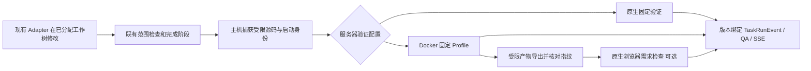

# 第一阶段：固定检查与测试容器化设计

状态：2026-10-18 用户已批准设计与 Native 顺序实现，选择先完成代码、稍后准备环境。
基线：main `8392b7f`。本设计承接 [候选方案](../../../docs/sandbox-options.md)，
以 [实施计划](../../../docs/superpowers/plans/2026-10-18-container-validation.md) 为配套，不代替实际 Docker 验收。

## 1. 目标、现状与取舍

目标是让内置前后端的固定验证命令可在无网络、受预算限制的 Linux 容器内运行；
保留现有 Adapter、默认原生演示路径、已有数据及完整历史证据。
成功只代表“固定检查/测试容器化”，不能称 Agent、预览或整个平台已经进入沙箱。

已核对的现状：

| 来源 | 当前事实 | 设计约束 |
|---|---|---|
| automatic_validation.py | vite-build-smoke-v1；check/build/test；512 文件、16 MiB；命令 60 秒 | 保留捕获边界、固定命令与公开函数兼容 |
| backend_validation.py | fastapi-contract-v1；语法及 12 项 ASGI 契约；拒绝原生模块输入 | 不运行目标 tests、配置或监听服务 |
| run_engine.py | 完成阶段在原有租约/监督所有权下调用验证 | 继续用现有取消及最终写入围栏 |
| task_runs.py | metrics.taskRunExecutionAccessBinding 含 executionAttemptId 等启动身份 | 使用冻结启动绑定，不把可变 runner_id 当永久版本 |
| TaskRunEvent / qa_assessment.py | v1 JSON 回执、源码/策略指纹和只读 currentness overlay | 增量 JSON，历史不回写 |
| qa-evidence.tsx | 展示 QA 分项和浏览器需求检查 | 分别标明命令环境和浏览器环境 |
| 本机只读检测 | 当前 PATH 无 docker；默认 Docker Desktop 路径不存在 | 尚无真实容器能力证据，不安装、不宣称可用 |

采用 **Docker CLI + 两个最小镜像 + 固定 Profile 执行后端**：无需新增 Python SDK，
按 Node 与 Python 分开锁依赖，减少镜像内容及混合运行时复杂度。
Docker SDK 方案增加依赖和 API 适配；一次迁移全部 Adapter/服务会扩大凭据与网络改动，
均不采用。宿主 native 路径继续保留。

## 2. 本期范围与不变量

- 默认 `AGENTHUB_VALIDATION_BACKEND=native`；允许值仅 native/docker。
- Docker 只承接内置 demo-frontend / demo-backend 的上述固定配置。
  其他目标不因此获得配置、命令或容器能力。
- CodexAdapter、ClaudeCodeAdapter、ScriptedMockAdapter 的协议、参数、权限和路由不变。
- 不挂载宿主 checkout/worktree、.git、.env、secrets、node_modules、数据库、
  附件、模型配置或 Docker socket；仅可挂载重新验证的服务器临时输入快照。
- 不改 models.py、固定 migration、seed、数据库 URL、已有 Agent/Workspace 设置。
- 预览、Provider CLI 与浏览器需求检查仍在原生路径；不新增端口映射。
- 公共 validate_copy / validate_backend_copy 默认及 runner 测试注入保持兼容；
  独立工作流评测调用不因全局选项偷偷改用 Docker。容器入口是有启动身份的 TaskRun 验证协调器。
- 本期不提供任意镜像、shell、命令参数、挂载、远程 daemon 或 Web 工具入口。

## 3. 组件与数据流

纯输入捕获与执行策略分离：Docker 捕获不依赖宿主 Node 可执行文件或宿主 Python
依赖版本；native facade 保留原依赖检查。共享路径、链接、配置白名单及文件预算检查，
不得复制另一套放宽的捕获器。新验证后端不接管 AgentAdapter 或用户队列。

主线程冻结 TaskRun ID、adapterRunId、启动绑定摘要及 executionAttemptId。
阻塞工作线程只接收不可变请求、cancelled Event 和服务器输出目录，不持有 SQLModel
Session，也不在线程中调用读写数据库的 ownership_guard。
现有监督/租约负责触发取消；最终发布仍在原线程复核所有权及 collecting_diff 状态。

## 4. 镜像准备和配置

两个 Linux/amd64 镜像：

| Profile | 运行时系列 | 内容 |
|---|---|---|
| vite-build-smoke-v1 | Node 22、Debian bookworm slim | demo 的锁定依赖、可信 build/smoke 脚本、固定容器控制程序 |
| fastapi-contract-v1 | Python 3.12、Debian bookworm slim | FastAPI 0.121.3、HTTPX 0.28.1 及锁定传递依赖、可信后端 harness |

补丁版本、基础镜像 repo digest、平台和 Python wheel 哈希在实施的镜像准备任务中
查询官方源、冻结并核验；未实际查询的 digest 不得填入示例假值或当成验收证据。
构建配方和依赖锁受版本控制；两个完成镜像的本地 image ID 来自真实 build/inspect，
不是 tag 或基础镜像 digest。未配置合法 ID 的 Docker 模式明确 unavailable。

配置为服务器环境变量：
`AGENTHUB_VALIDATION_FRONTEND_IMAGE_ID`、`AGENTHUB_VALIDATION_BACKEND_IMAGE_ID`
仅接受 sha256 加 64 位十六进制；`AGENTHUB_VALIDATION_DOCKER_CONTEXT` 必须显式指定
受信本机 context（由准备回执给出），Docker 模式缺少该配置即 unavailable；
不隐式沿用用户当前默认 context。先解析该 context，再把所有 daemon 操作显式绑定到
已核验的本机 endpoint；不在实际操作时重新按可变名称解析。使用服务器临时空客户端配置，
避免用户 config.json 代理/凭据被自动注入；实际容器 Env 必须匹配不可变镜像和固定变量。
context 仅允许本地 Unix socket / Windows named pipe，拒绝 TCP、SSH、远程 daemon；
抑制 DOCKER_HOST/API_VERSION 等继承覆盖，不向容器传递 Docker 客户端环境。

规划开发者入口：
- `pnpm sandbox:doctor`：只读 version/info/context/image inspect；不导入 DB、
  创建容器、拉镜像、安装、启动 daemon 或修改配置。区分静态准备就绪与隔离已实测。
- `pnpm sandbox:prepare --output <新建外部绝对目录>`：明确的操作员构建动作，
  只从受信平台文件生成最小临时 build context，输出配方/依赖/镜像 ID 回执。
  拒绝已有目录、repo/worktree 内目录及链接路径；不扫描或发送整个仓库。
- 前端复用 pnpm 10.33.4 与 frozen lock，包含必要的受信 patches；Python 使用
  独立的带完整哈希的验证依赖锁。网络与依赖下载仅发生在显式准备阶段。
- 执行阶段严格 pull=never，不运行 pip/pnpm/npm 安装，不执行目标 package scripts。
- 镜像内不含用户项目源码、Playwright/浏览器、平台数据库或 Provider CLI/凭据。
- `pnpm sandbox:verify`：显式强制真实容器资格验证，复用现有 test-api.sh 外部数据库/
  JUnit 包装；环境缺失必须失败。它与只读 doctor 是不同入口。

doctor 输出 agenthub.container_doctor.v1：status 为 metadata_ready/unavailable/unsupported，
reasonCodes 为有界固定码，checks 为 id/status 项，runtimeIsolationVerified 始终 false；
只有 metadata_ready 退出 0，其他退出 1。准备回执为 agenthub.container_images.v1，
profiles 按上述 Profile 存 imageId/recipeFingerprint/platform/contextName，另外记录
基础镜像、依赖和 harness 哈希；准备成功不自动启用 Docker 配置。

这些入口不是 Agent 命令，不授予 Agent Docker 权限。

## 5. 容器边界与资源预算

每次 Profile 一个容器，由服务器建立并逐个 exec 固定阶段：
prepare → check → build（仅前端）→ test → export → remove。
镜像只提供固定 keeper 和按枚举选择的控制程序，不接受自由 shell/argv。
前端脚本在镜像保持 scripts 与 apps/demo/package.json 的既有相对布局，
使 createRequire 解析到镜像依赖；工作副本的 node_modules 只链接该镜像内位置。

固定策略 container-validation-v1：
- user 10001:10001；init=true 回收子进程；只读根；network none；无发布端口、额外 host、设备或 host namespace。
- cap-drop ALL、no-new-privileges、默认 seccomp；不允许 privileged、unconfined 或 Docker socket。
- 1 CPU、内存 1024 MiB、memory-swap 同为 1024 MiB、pids-limit 128。
- /work tmpfs 512 MiB、/tmp tmpfs 64 MiB；nosuid/nodev/noexec，固定非 root 可写权限。
  可执行工具全部来自镜像。tmpfs 计入内存预算，不能当额外免费磁盘。
- 只读 /input 挂载由服务器创建、填充和重新核验的专用快照目录；不能挂载原工作树。
  CLI 使用 argv 列表及 shell=False；快照绝对路径若含逗号、引号或换行则拒绝，
  避免 --mount 自身的参数语法产生另一个挂载解释；空格和中文路径作为单独参数处理。
- 单阶段最多 60 秒，取得容量后整个 Profile 最多 180 秒（含准备/导出）。
  Docker 管理调用最多 10 秒；取消时终止 exec 客户端及经核验归属的容器。
- 命令公开日志每阶段最多 12,000 字节，持续排空后丢弃超额内容；日志不构成结构化成功证据。
  关闭持久 Docker 日志、restart=no；不使用 auto-remove，先 inspect 退出/OOM 原因再精确清理。
- 每用户/本机 daemon 的 AgentHub 验证容量为 1；跨进程文件锁，最多等 30 秒且可取消。
  不占 SQLite 写事务等待，不复用数据库维护独占锁，不改变现有任务调度并发。

上述为拟实施的固定起始预算，必须实测；OOM/资源不足如实失败，不自动放大限额。
doctor 仅核对可查询元数据，实际 enforcement 由真实容器负例证明。
只读输入和受限工作副本保持既有修改检测，不能取消现有 Python audit guards。

## 6. 产物导出与原生浏览器检查

保留 tmpfs；不用 docker cp 直接复制 tmpfs，也不将 tar 解包到宿主。
Docker 官方说明该类内容需通过 exec 等方式读取，见末尾来源。

固定 export 控制程序在容器仍运行时，用独立进程核对工作副本源文件摘要、
新增文件及预期依赖链接，读取前端 dist；后端不回传应用数据。
返回 agenthub.container_export.v1 的单个 UTF-8 JSON，字段为 schemaVersion、
sourceFingerprint、sourceFiles（工作副本输入相对路径到 SHA-256 的 map）和
files（dist 相对路径 path、sha256、base64 的对象数组；后端为空数组）。
sourceFiles 必须与快照 contents 的实际字节哈希逐项一致；原 sourceFingerprint 中
根依赖策略文件的哈希仍由主机重新核对，不靠未复制的文件作容器自证。
不得跟随链接；拒绝非普通文件、多链接和任何非预期后台进程。
服务器核对阶段完成、容器归属/状态、输入版本和清单；不把容器 stdout 自述当成功。
这不是远程硬件证明，也不承诺抵御所有恶意语言运行时反射行为。

输出预算：最多 512 个文件、总解码 32 MiB、单文件 5 MiB、传输 48 MiB、深度 16。
主机严格解码并自算摘要；拒绝重复/大小写冲突、绝对路径、盘符、ADS、反斜线、
控制字符、空组件、点/父目录及保护路径。路径必须已是 NFC，按 NFC/casefold 拒绝冲突；
拒绝 Windows 设备名（含扩展名形式）、末尾空格/点；每段 UTF-8 最多 120 字节，
整条最多 240 字节。JSON 重复键或非有限数也拒绝，不在公开日志中打印导出正文。
逐文件独占创建于新的服务器临时目录，
不调用 extractall、不生成符号/硬链接、不覆盖现有文件。失败清理仅限已核验的该目录。
导出程序和宿主复核都不能修改 canonical 文件。

有 requirement contract 时，以该临时 dist 调用现有可信 Playwright harness；
它仍在宿主、保持 sandbox 和网络拦截，记录 functional.execution.backend=native
及输入产物指纹。没有宿主浏览器时 functional=unavailable、整体 incomplete，
即使命令均在 Docker 通过也不能宣称需求验收通过。此期不将产物复制回预览工作树，
原生预览仍使用 canonical 已交付源码，不预览未合入的并行分支。

## 7. 生命周期、归属与重启

状态为 reserved → creating → created → running → exporting → cleaned，异常进入 cleanup_required。
创建前写服务器私有 journal：operation nonce、context、启动绑定、输入目录、
image ID、API PID/启动身份；取得 ID 后原子追加。容器 label 绑定相同身份及策略。
journal 位于用户临时目录的固定 AgentHub 容器子树，不在数据库中，拒绝链接/任意路径；
任务/Agent 不可指定 journal、容器 ID 或清理路径。

每次 start/exec/inspect/kill/remove 前核对归属、image ID、label、固定挂载及已分配 ID。
跨进程容量锁释放前必须确认容器消失；清理失败保留 journal 并停止新 Docker 验证。
API 崩溃释放 OS 锁后，下次获得容量先处理同一受信 journal 的旧资源：
核验原进程确实退出、完整归属和失效运行身份，才允许精确回收。
create 调用前持久化 createAttempted 和冻结 endpoint；调用超时/断连且未拿到 ID 时，
一次空查询不能证明 daemon 未创建资源，须保留 journal/输入并阻止新验证。
创建后尚未来得及记 ID 的窗口只按该 journal 的 operation label 查找并严格复核，
不能凭容器名称前缀或数据库中某个 ID 接管/删除。

不可信或无法确认已失效的资源只报告 cleanup_required，不删除用户容器、不运行 prune。
keeper 自带 180 秒最大生命期；宿主取消/关闭走 finally 清理。不会 pause 容器，
避免暂停的 keeper 无法到期退出。失去执行所有权只清理自己的资源，
不得发布旧运行的 completed；重启不能重放同一 TaskRun 的中断验证。

## 8. 回执、有效性与界面

保留 agenthub.validation.v1 和两个 Profile 名称，增量 execution 对象：
backend、operationId、imageId（Docker）、recipeFingerprint、runtimePolicyId、
generationFingerprint、contextFingerprint、commandsBackend。
启动/完成用既有 validation.started/completed；不新增数据库列。
最终容器 ID/退出与 OOM 原因可以进入有界执行证据，不输出宿主路径或客户端配置。

generationFingerprint 取冻结 metrics.taskRunExecutionAccessBinding 的规范摘要，
并与 taskRunId/adapterRunId 联合校验；不可直接以终态可变 runner_id 或后来释放的锁行
判断历史验收。currentness 还核对原事件中的 execution 及原有源码/需求/策略指纹，
防止把 native 回执改标 docker 或借用另一运行。

Docker policy 绑定配置后端、具体 image ID、配方/依赖/harness 哈希、资源策略、
最小容器环境及必要浏览器策略；变更后旧结果只读显示 expired/unverifiable，
不回写历史。currentness 是本地纯核对，不因打开报告调用 Docker daemon。
镜像已删除是下一次执行的可用性问题，不撤销已证明的历史执行事实。

旧 execution 缺失时展示“历史验证（环境未记录）”，native 下沿既有规则核对；
切换到 Docker 策略后该旧回执显示 expired，不能满足当前 Docker 验证。
不补造 Docker 信息；真正策略变更时允许原有 currentness 机制使其过期。
命令区显示“Docker 固定验证”或“原生固定验证”，浏览器区单独显示“原生浏览器检查”。
backend 表示请求的模式；commandsBackend 只有实际执行后才为 docker/native，
否则为 not_run。Docker unavailable 必须显示“请求 Docker · 未运行/环境不可用”，
不能因配置选中 Docker 就显示容器执行成功。
模型评审仍是独立维度，容器成功不能覆盖规则违规、模型未运行或缺失需求证据。

Docker 不可用 → unavailable/QA incomplete；命令失败或 OOM → failed；
超时、取消沿用既有枚举并附 reasonCode；输入或策略变化 → stale。
仅可靠的 daemon/cgroup 诊断才能标记 OOM；exec 退出 137 本身只说明被杀，
不能在 keeper 存活、State.OOMKilled=false 时编造已确认的 OOM 原因。
编码 TaskRun 是否完成继续遵循原有完成边界，不把 validation unavailable 偷改为通过。

## 9. 已有数据与回退

无表、列、revision、seed 或迁移命令改动；不访问/挂载/复制真实产品库到容器。
新运行只追加原有事件和正常结果数据，既有 workspace、session、消息、附件 BLOB、
Skills/MCP 设置、Artifact、TaskRun 和评审保持原值与标识。

用独立 current 临时库构造旧数据及旧 v1 回执，记录业务行/附件哈希、版本和外键，
分别运行新 native 与 Docker 任务后比较既有行；新增合法运行记录不计为旧数据修改。
Alembic head 和 schema 契约必须一致；不得靠重置、stamp 或 seed 回填通过测试。

回退只将验证后端显式配置为 native，影响新验证；旧结果保留且按当前策略判断有效性。
不迁移数据、不删除镜像/历史或替换任何 Adapter。默认 native 不要求 Docker 存在。

## 10. 验收与完成边界

实施顺序见 tasks.md；只能在用户后续授权后一次执行一个任务。
单元测试替身验证 argv、边界、取消及证据逻辑，不能证明 OS 隔离。
真实 Linux Docker 必须验证两类 Profile 正反例、只读/凭据/网络/宿主端口不可达、
PID/内存/超时、并发容量、API 异常退出/重启归属清理及产物恶意路径拒绝。
可预设较小限额的资源负例必须记录测试策略，不能冒充生产预算容量测试。

默认 CI 继续 native；单独 workflow_dispatch 容器工作流在明确触发时构建镜像并运行
强制真实容器测试，缺少 daemon/镜像/能力必须失败，不能 skip 后宣称 Docker 完成。
至少一套真实 Docker 全链路以 ScriptedMock 实际文件变更验证 Diff、回执及原生预览；
三个 Adapter 原有协议/取消/回退回归均保留。若没有实际调用模型，
验收明确标记仅验证接口兼容，不伪称真实 Codex/Claude 容器执行。
规划时本机无 Docker；用户随后批准先实现、环境稍后准备。实际镜像构建与真实隔离证据仍是完成验收的门槛。

## 11. 官方依据

以下文档于 2026-10-18 核实，具体 flags 与平台兼容还需实际镜像验收：
- [运行接口与固定 image ID/资源选项](https://docs.docker.com/engine/containers/run/)
- [内存、CPU 与 memory-swap](https://docs.docker.com/engine/containers/resource_constraints/)
- [tmpfs 生命周期与限制](https://docs.docker.com/engine/storage/tmpfs/)
- [无网络模式](https://docs.docker.com/engine/network/drivers/none/)
- [cp 的 tmpfs 限制](https://docs.docker.com/reference/cli/docker/container/cp/)
- [exec 生命周期](https://docs.docker.com/reference/cli/docker/container/exec/)
- [daemon 权限模型](https://docs.docker.com/engine/security/)
